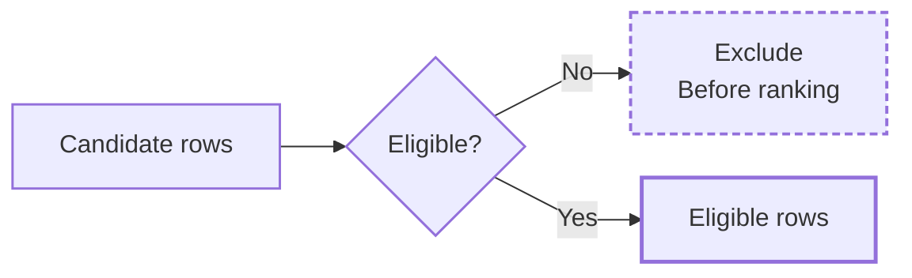
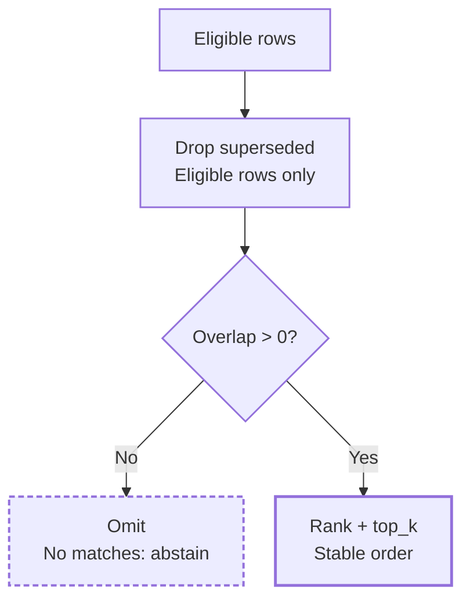

# Temporal Memory Core

An office moved on **February 1**. The assistant only found out on **February 10**.

Someone asks: "What did we know on February 5?"

A memory system that ignores *when it learned something* will confidently use future knowledge to answer a question about the past. Very helpful. Also time travel.

This Python component keeps two clocks:

| Clock | What it asks |
| --- | --- |
| **Valid time** | When was the fact true in the world? |
| **Knowledge time** | When did this system know about it? |

So a query for February 5 with knowledge cut off on February 5 **excludes** the move. A query about February 5 with knowledge available through February 20 can include it. Same historical date, different knowledge boundary.

## It's more than timestamps

Before relevance scoring, retrieval checks valid time, known time, allowed use, and active status. Only eligible memories get to supersede older ones. After that, the public ranking uses lexical overlap — deliberately simple, not secretly a giant language model hiding under the floorboards.

No eligible match? Return nothing rather than pretending.

## The retrieval order matters

A perfect search match is still excluded if the system wasn't allowed to know or use it at that time.

Only then does ranking decide which surviving memories are relevant.

Look at [time logic](src/temporal_memory/time.py), [filters and supersession](src/temporal_memory/filters.py), [ranking](src/temporal_memory/ranking.py), and [tests](tests/). The [eligibility table](docs/eligibility-table.md) has the complete rules.

The sample uses synthetic facts. No personal memory dump, vector index, persistence service, authenticated user access, or deployed AI assistant is included. [Verification](docs/verification.md) · [provenance](PROVENANCE.md).
