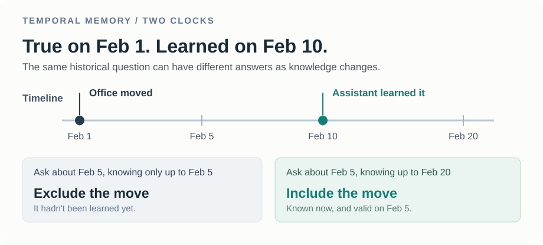

# Temporal Memory Core

An office moved on **February 1**. The assistant only found out on **February 10**.

Someone asks: "What did we know on February 5?"

A memory system that ignores *when it learned something* will confidently use future knowledge to answer a question about the past. Very helpful. Also time travel.

**Valid time** is when the fact was true. **Knowledge time** is when the assistant learned it. Querying February 5 with knowledge cut off on February 5 excludes the move. Querying that same date with knowledge available through February 20 can include it.

## It's more than timestamps

Before relevance scoring, retrieval checks valid time, known time, allowed use, and active status. Only eligible memories get to supersede older ones. After that, the public ranking uses lexical overlap — deliberately simple, not secretly a giant language model hiding under the floorboards.

No eligible match? Return nothing rather than pretending.

Eligibility happens before relevance. Use permissions, valid-time bounds, knowledge-time bounds, and active status filter candidates; only eligible rows may supersede older memories. **Then** lexical ranking decides what matches.

Look at [time logic](src/temporal_memory/time.py), [filters and supersession](src/temporal_memory/filters.py), [ranking](src/temporal_memory/ranking.py), and [tests](tests/). The [eligibility table](docs/eligibility-table.md) has the complete rules.

The sample uses synthetic facts. No personal memory dump, vector index, persistence service, authenticated user access, or deployed AI assistant is included. [Verification](docs/verification.md) · [provenance](PROVENANCE.md).
